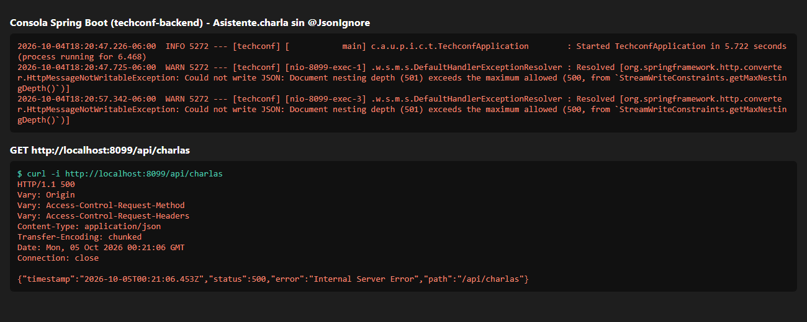

# IF0009 - Laboratorio 12: Expansión TechConf

**Estudiante:** Andreé Murillo Sojo - C4H877

Proyecto full-stack de TechConf: backend en Spring Boot con H2 y frontend en Angular con Reactive Forms.

## Estructura

```
techconf-backend/    API REST (Spring Boot 4, Java 21, H2)
techconf-frontend/   SPA (Angular 22)
docs/                Captura del error de recursión (Parte 2)
```

## Cómo ejecutar

**Backend** (puerto 8080):

```bash
cd techconf-backend
./mvnw spring-boot:run
```

Consola H2: http://localhost:8080/h2-console (JDBC URL `jdbc:h2:mem:techconf`, usuario `sa`, sin contraseña).

**Frontend** (puerto 4200):

```bash
cd techconf-frontend
npm install
npm start
```

## Endpoints

| Método | Ruta | Descripción |
|---|---|---|
| GET | `/api/charlas` | Lista las charlas con sus asistentes |
| GET | `/api/charlas/{id}` | Obtiene una charla con sus asistentes |
| POST | `/api/charlas` | Registra una charla (puede incluir asistentes) |
| POST | `/api/charlas/{id}/asistentes` | Inscribe un asistente en la charla |

Ejemplo de inscripción:

```json
POST /api/charlas/1/asistentes
{ "nombre": "Ana Perez", "correo": "ana@correo.com", "edad": 20 }
```

Respuestas: `201` si se inscribe, `400` si los datos no son válidos (por ejemplo, menor de 18) y `404` si la charla no existe.

## Parte 1: Resumen de lo implementado

**Backend**
- Entidad `Asistente` (id, nombre completo, correo, edad) con validaciones `@NotBlank`, `@Size(min = 3)`, `@Email` y `@Min(18)`.
- Relación bidireccional: `Charla` tiene `@OneToMany(mappedBy = "charla")` y `Asistente` tiene `@ManyToOne` con `@JoinColumn(name = "charla_id")`.
- `data.sql` con 3 charlas y 6 asistentes repartidos entre ellas.
- Endpoint `POST /api/charlas/{id}/asistentes`.

**Frontend**
- Botón "Inscribir Asistente" en cada tarjeta de la agenda que despliega el formulario `InscripcionForm`.
- El formulario es anidado: un `FormGroup` principal que contiene el `FormGroup` `asistente` con `nombre`, `correo` y `edad`.
- Validaciones: `nombre` requerido y mínimo 3 caracteres, `correo` requerido y con formato de email, `edad` requerida y con el validador personalizado `mayorDeEdadValidator`.
- Al inscribir, se hace el POST y la tarjeta se actualiza mostrando el nuevo asistente.
- El formulario de "Registrar charla" tiene un `FormArray` para agregar o quitar asistentes de forma dinámica, cada uno con las mismas validaciones.

## Parte 2: Análisis y depuración del error de recursión

### El problema

`Charla` tiene una lista de `Asistente`, y cada `Asistente` tiene una referencia a su `Charla`. Cuando Jackson convierte una charla a JSON, recorre la lista de asistentes; al serializar cada asistente encuentra el campo `charla`, vuelve a serializar la charla, luego su lista de asistentes otra vez, y así sin fin:

```
Charla -> asistentes -> Asistente -> charla -> asistentes -> Asistente -> ...
```

### Cómo se provocó

1. En `Asistente.java` se comentó la anotación `@JsonIgnore` del campo `charla`.
2. Se levantó el backend y se hizo `GET /api/charlas`.
3. El servidor respondió **500 Internal Server Error** y en la consola apareció:

```
HttpMessageNotWritableException: Could not write JSON: Document nesting depth (501)
exceeds the maximum allowed (500, from `StreamWriteConstraints.getMaxNestingDepth()`)
```



**Nota:** en versiones anteriores de Spring Boot (Jackson 2) este mismo error aparece como `StackOverflowError`. Spring Boot 4 usa Jackson 3, que tiene un límite de anidamiento de 500 niveles y corta la recursión antes de que se desborde la pila, por eso el mensaje es diferente, pero la causa es la misma: la referencia circular.

### Cómo se resolvió

1. Se volvió a colocar `@JsonIgnore` (de `com.fasterxml.jackson.annotation`) sobre el campo `charla` en `Asistente`:

```java
@JsonIgnore
@ManyToOne
@JoinColumn(name = "charla_id", nullable = false)
private Charla charla;
```

2. Se recompiló y se volvió a consultar `GET /api/charlas`, que respondió **200 OK** con cada charla y su lista de asistentes.

Con `@JsonIgnore`, Jackson no serializa el lado `@ManyToOne`, así que el ciclo se corta: la charla muestra sus asistentes, pero los asistentes no vuelven a mostrar la charla. Además, como el campo también se ignora al leer el JSON de entrada, en el controlador se asigna la charla manualmente con `asistente.setCharla(charla)` antes de guardar.

### Directivas de Jackson

- **Usada:** `@JsonIgnore` en `Asistente.charla`.
- **Alternativa:** `@JsonManagedReference` en `Charla.asistentes` y `@JsonBackReference` en `Asistente.charla`, que hacen lo mismo indicando cuál es el lado "padre" y cuál el "hijo". Se eligió `@JsonIgnore` porque es lo que pide el enunciado y es más simple.
